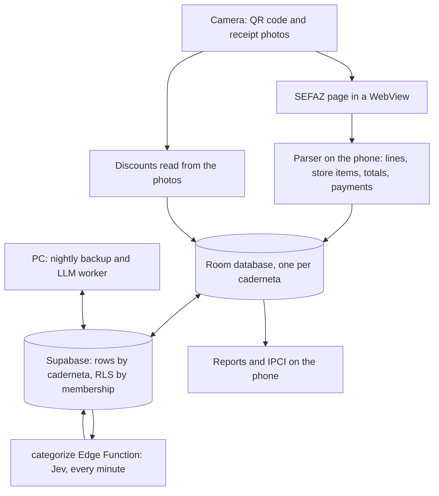

# Architecture

How the parts fit together today (2026-10-29). For why, see [decisions.md](decisions.md); for the current state and
open items, [status.md](status.md).

The phone does the work: capture, the SEFAZ page, parsing, the catalog, reports. Supabase holds a synced copy shared
by a caderneta's members and runs the categorizer. A PC runs nightly jobs. The phone works without an account.

## On the phone (`android/`)

Kotlin and Jetpack Compose, one module, package `io.github.sandroroque.getnf`:

| Package | What's in it |
| --- | --- |
| `ui/scan` | The live capture (D82–D97): QR code, paper finder, the receipt assembled from OCR rows, the fewest photos kept |
| `ui/page` | The SEFAZ page in a WebView, the lookup budget check (D16, D17, D99–D101) |
| `parse` | [NfcePage.kt](../android/app/src/main/java/io/github/sandroroque/getnf/parse/NfcePage.kt) reads the page; [Derive.kt](../android/app/src/main/java/io/github/sandroroque/getnf/parse/Derive.kt) makes store items and line discounts; buyer redaction |
| `discounts` | OCR of the saved photos, pairing discount lines with items (D54, D101) |
| `data` | Room ([ReceiptDatabase.kt](../android/app/src/main/java/io/github/sandroroque/getnf/data/ReceiptDatabase.kt), v11), the receipt store, the catalog and its editor, spending and IPCI, backup/restore, the lookup budget |
| `sync` | [SyncEngine.kt](../android/app/src/main/java/io/github/sandroroque/getnf/sync/SyncEngine.kt) and its worker, cadernetas (ledgers), photo uploads and withdrawal, the page reminder |
| `ui/*` | The four tabs (D81): Início, Gastos, Para você, Catálogo; Ajustes; the "Calmo" theme |

- **The page is the source of a receipt's data.** The parser runs on the phone, and the page is saved, so a parser
  change can re-read every receipt. Photos are the archive and the source of per-item discounts. A reader that makes
  the receipt from the photos alone is planned (D106).
- **Each caderneta has its own database file and receipts folder** (D104). Opening another restarts the app.
- **Ids:** store items and parser-made products have ids derived from their codes, so two phones make the same rows.
  A product is keyed by GTIN, or by store CNPJ plus the store's code for in-store items.
- **Export/restore:** one zip with the database and photos, from Ajustes (D47).

## Sync and Supabase (`supabase/`)

- **Schema** in [migrations](../supabase/migrations/), São Paulo region. Every row belongs to a caderneta (`ledger`);
  Row Level Security lets members only. Ids are unique per caderneta: upserts use `ledger_id,id`.
- **Sync** (D70, D104): pull the taxonomy, push dirty rows parents first, pull what changed since the last cursor,
  never overwriting a local change. A row the server refuses is parked (`sync_parked`) instead of failing the run.
- **Storage:** a private bucket, a folder per caderneta. Photos go up only if the user opts in, and only for receipts
  the app failed with, with sensitive parts blanked (D98, D103).
- **Categorization** ([functions/categorize](../supabase/functions/categorize/)): Jev runs on new store items every
  minute. Confidence ≥ 0.9 sets the category; below it, a suggestion for Para você (D74).
- **Tests:** pgTAP in [tests/database](../supabase/tests/database/) (`npx supabase test db`).

## On the PC (`tools/`)

systemd user timers ([tools/systemd](../tools/systemd/)):

- 03:30 [supabase-backup.py](../tools/supabase-backup.py): a dump of the online project (D73); restore drills with
  `supabase-restore-drill.sh`.
- 04:00 [llm-worker.py](../tools/llm-worker.py): a local LLM (LM Studio) audits categories and suggests links and
  categories; the user decides on the phone (D80).

Their credentials, and the build's, are in `.env.local` at the repo root (gitignored; a worktree uses the main
checkout's).

## The site (`web/`)

Static pages at https://caderneta.roqlab.com.br: the landing page, the privacy policy, account deletion (D105). See
[web/README.md](../web/README.md).

## What the numbers mean

- Spending measures the receipts captured, not everything spent. A month without receipts isn't a month of zero.
- Periods follow the issue date, in the issuing state's time zone.
- A receipt-level discount is prorated over its lines until the photos show which item had it.
- A product has one category, so category totals add up; tags overlap and aren't summed.
- Reports use each product's current category; past classifications aren't kept.
- The IPCI (D79) follows the price paid for the same products month to month, and says "dados insuficientes" when
  there aren't enough repeated purchases.
