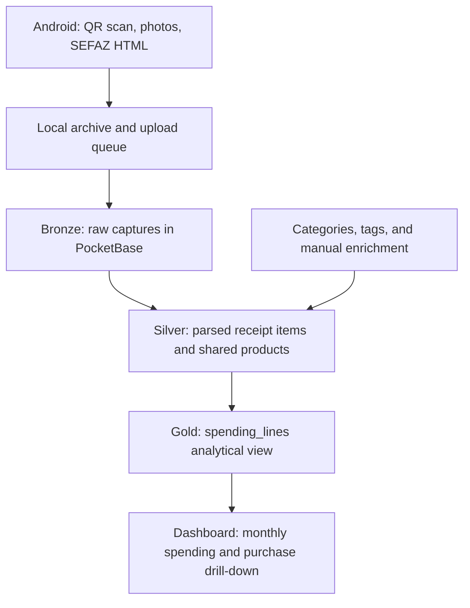

# Architecture

getNF captures NFC-e receipts on Android, preserves the source files, and derives structured data for spending analysis.
The phone handles capture and queued uploads; PocketBase handles storage and parsing; a web dashboard reads the
analytical view to group purchases by month, category, and product.

## From capture to analysis

The pipeline follows the medallion pattern through **logical layers**:

| Layer | Current implementation | Responsibility |
| --- | --- | --- |
| Bronze | Saved photos, HTML, QR/page URLs, chave, and capture timestamps | Preserve source evidence independently of the parser |
| Silver | Parsed receipt fields, `receipt_items`, `products`, categories, and tags | Structure and enrich data, resolve product identity, and allocate discounts |
| Gold | SQL view `spending_lines`, followed by dashboard aggregations | Expose analytical dimensions and measures for spending questions |

These layers share PocketBase/SQLite. The `receipts` collection holds both raw capture references and derived summary
fields. Gold is a line-level analytical view; monthly/category/product aggregates are calculated in the dashboard,
rather than persisted in separate aggregate tables. This is a compact implementation of the pattern.

Raw captures allow receipt parsing to be repeated when the parser changes. Parser versions and file references select
receipts for reprocessing; item replacement runs in a transaction. Manual product classifications and size corrections
are separate enrichment inputs and need backups: they cannot be reconstructed from raw HTML alone. Raw preservation
does not currently provide an immutable, versioned history of every capture or enrichment change.

## Processing and consistency

The Android [receipt store](../android/app/src/main/java/io/github/sandroroque/getnf/data/ReceiptStore.kt) saves captures
locally before upload. Continuous camera attempts first use private temporary sessions. A complete connected
capture is imported as one idempotent batch; local metadata retains segment masks, polygons, coverage and quality.
Incomplete exit keeps only the identified code when explicitly selected; existing receipt evidence remains intact.
The original JPEG segments are uploaded through the existing photo field; masks and segment metadata currently
remain local. See [automatic-capture.md](automatic-capture.md).

A local version and the last confirmed uploaded version track pending changes. The
[upload worker](../android/app/src/main/java/io/github/sandroroque/getnf/upload/UploadWorker.kt) retries network failures;
the [API client](../android/app/src/main/java/io/github/sandroroque/getnf/upload/PocketBaseClient.kt) upserts by chave so
repeated uploads target the same receipt.

On the server, the [parser](../server/pb_hooks/lib/nfce_page.js) extracts items and totals from saved HTML. Count and
total discrepancies are recorded in `parse_error` without rejecting the raw upload. The
[ingestion hooks](../server/pb_hooks/lib/ingest.js) replace a receipt's derived items in one transaction and track the
parser version for later reprocessing.

The [derived model](../server/pb_migrations/1791600000_derived_data.js) separates receipt lines from shared products.
Products are keyed by GTIN or issuer CNPJ plus store code. Classification belongs to the product, so purchases reuse
the same category. [Derivation helpers](../server/pb_hooks/lib/derive.js) allocate discounts in integer cents and extract
package sizes for normalized prices. Manual size corrections survive reprocessing.

The [analytical SQL view](../server/pb_migrations/1791600001_spending_view.js) exposes one row per receipt line with
time and category dimensions, gross amounts, discounts, and net amounts. The
[dashboard model](../server/pb_public/dashboard/model.mjs) aggregates net spending in cents and keeps quantities
separate by unit. Users can drill down from monthly totals to categories, products, and individual purchases.

## Validation and deployment

Parser and derivation modules run both in PocketBase and in Node tests. [Server tests](../server/test/) cover parsing,
discount allocation, and dashboard reconciliation and edge cases; [Android tests](../android/app/src/test/java/io/github/sandroroque/getnf/)
cover local storage, chave validation, lookup budgets, and page request filtering. HTML fixtures are reduced and
sanitized with the [fixture generator](../tools/make-nfce-fixture.py).

[Docker Compose](../server/compose.yaml) runs PocketBase and mounts the dashboard and taxonomy files. Collection
schemas and the analytical view are defined in versioned [migrations](../server/pb_migrations/).
[Decision records](decisions.md) explain the implementation choices.

## Analytical meaning and current boundaries

- Spending measures captured receipts, not all personal expenditure. A month with no receipts does not establish zero spending.
- Time buckets use issue dates rather than capture dates. The current analytical view uses UTC-3 for Santa Catarina.
- Item discounts are generally prorated from the receipt total. The model can preserve photo-derived discounts, but the photo extraction workflow is future work.
- A product has one main category, allowing additive category totals. Tags overlap and should not be summed as exclusive groups.
- Product classification and size corrections reflect current enrichment; historical classification snapshots are not implemented.
- Weekly/quarterly/yearly dimensions exist in the analytical view; the current dashboard presents monthly analysis.
