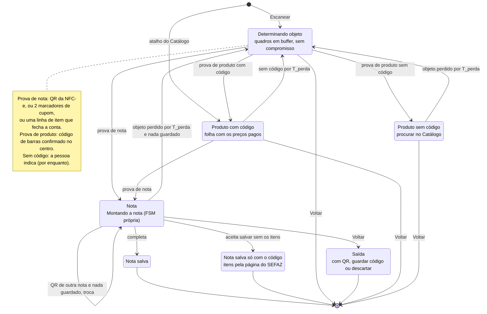
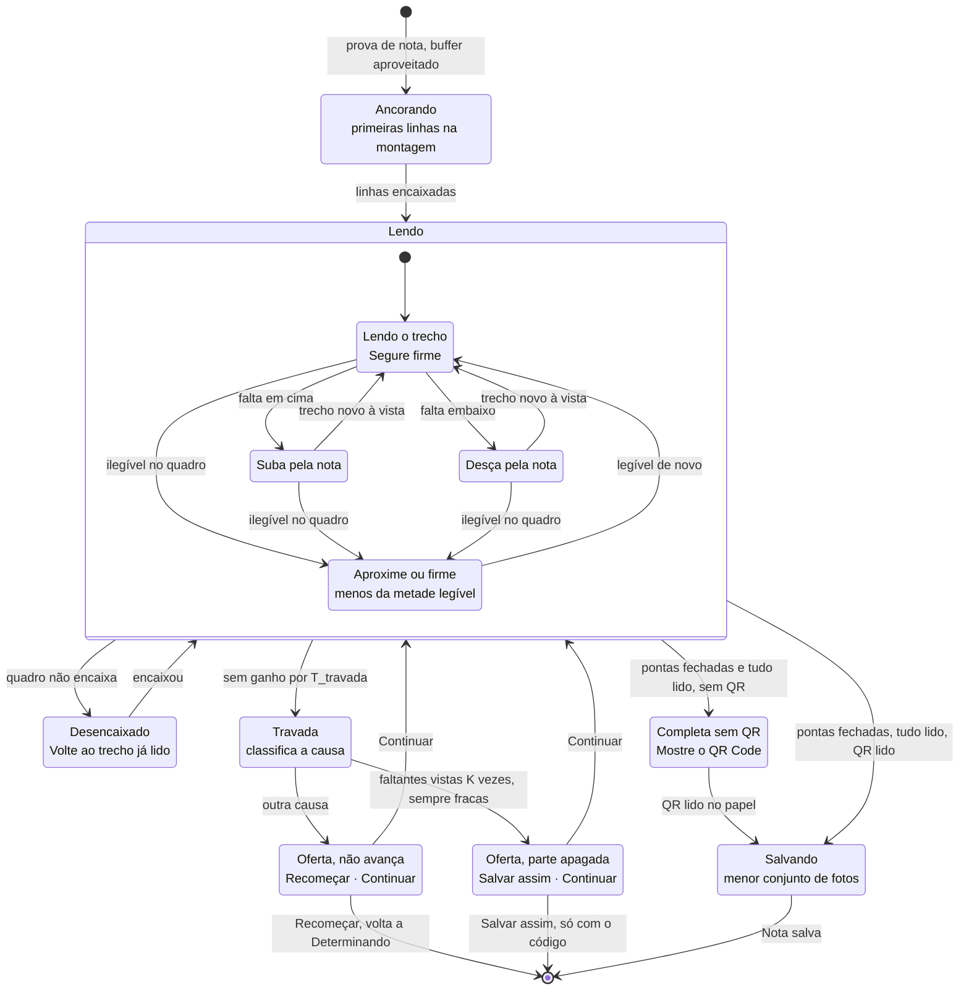
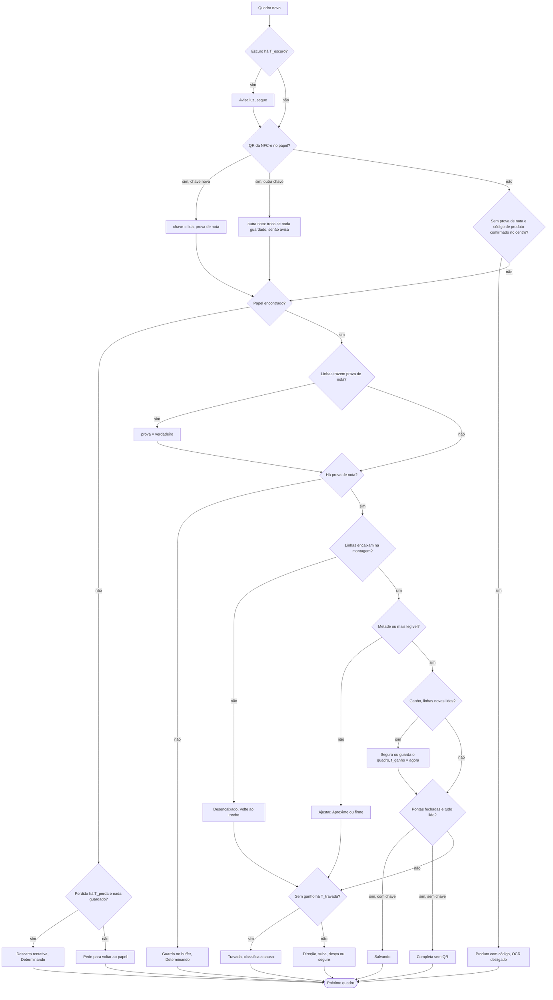

# The capture loop, idealised (draft, 2026-10-31)

A first definition to compare with today's ([capture-fsm.md](capture-fsm.md)); critique and compatibility come later.
Three pieces: the outer machine decides the object, the inner one assembles a receipt, and every frame answers a fixed
sequence of questions whose answers update the control variables that fire both machines' transitions.

## Control variables

| variable | meaning |
|---|---|
| `prova` | evidence of a receipt: the NFC-e QR, 2 receipt markers ("Documento Auxiliar", "Qtd. total de itens", "Valor total", "Consulte pela chave", CNPJ), or an item row whose arithmetic holds |
| `chave` | the receipt's access key, from a QR inside the paper |
| `guardado` | at least one photo saved for this attempt (a commitment: nothing is dropped by itself after it) |
| `buffer` | frames seen while undetermined, handed to the assembly once there's proof |
| `t_visto` / `t_ganho` | last time the object was in view / last time a new row was read |
| `pontas` | the paper's top and bottom seen at the rows |
| `fracas[row]` | frames that saw a missing row and read it below the legibility bar |
| timers | `T_perda` (object lost, ~2.5 s), `T_travada` (no gain, ~6 s), `T_escuro`; `K` frames for "worn" |

## Outer machine

## Inner machine: Montando a nota

## Every frame: the questions, in order

