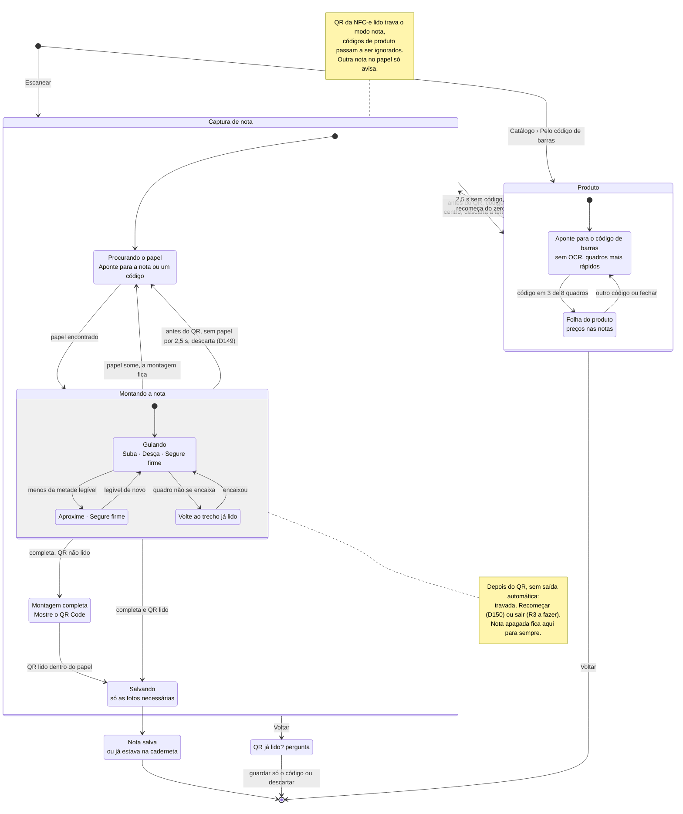

# The capture loop as a state machine (as of D150)

How the camera behaves today, from `ui/scan/CameraMode.kt` (`CameraModeDecider`), `ui/scan/IngestSession.kt` (the
hints and completion) and `ui/scan/LiveCapture.kt` (QR, saving, exit). The notes mark the gaps discussed on
2026-10-31: an attempt is never dropped by itself (except for a product), and a worn receipt never completes.

Details the diagram leaves out:

- **Complete** means both paper ends seen, every row that must be captured read in a kept photo (or shown, for rows
  not to be read), and no unread print between required rows (`IngestSession.required`, `completeWith`).
- **Legible** (per frame): row confidence ≥ 0.5, weakest box ≥ 0.6, median of the 3 rows either side ≥ 0.6, at least
  20 px tall, not cut by the frame. A row 3 frames couldn't read while reading its neighbours is taken for a logo and
  no longer required.
- **Over every state:** the torch is on from the start (D117); "Outra nota à vista" when another receipt's QR is
  inside the paper; leaving the app keeps the code (`close()` → keep code); the product camera opened from the Catálogo
  never takes a receipt.
